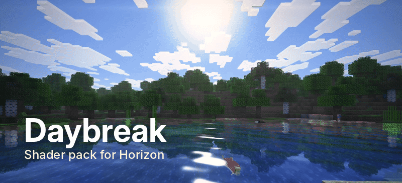
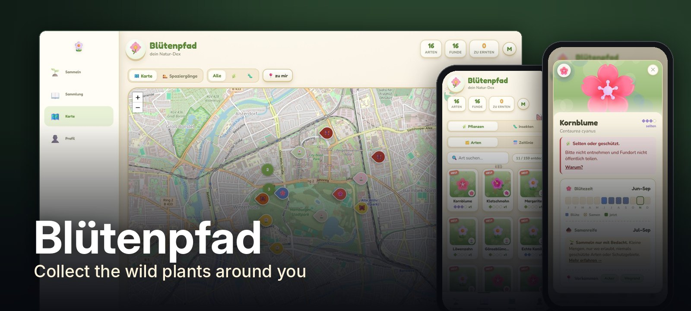
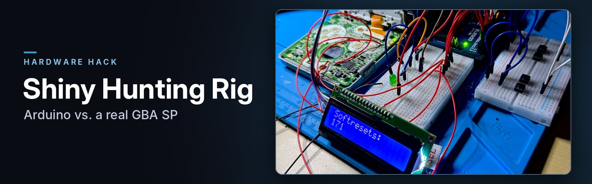

  

Hi, I'm Hannes from Germany, an IT systems electronics engineer focused on AI-assisted development, automation,
infrastructure and hardware.

## Projects

<h3><a href="https://github.com/hildlabs/horizon-shaders">Daybreak</a> SHADER PACK</h3>

Sun shadows, reflective water, waving plants, sun rays and bloom for <a href="https://github.com/horizon-rust/horizon">Horizon</a>, the Rust reimplementation of Minecraft. Four quality presets.

 

 

<h3><a href="https://github.com/hildlabs/openrig-studio">OpenRig Studio</a> AI TOOL</h3>

Describe a move, get a Roblox R15 or R6 animation. Runs on Claude Code, the Codex CLI or your own API keys, previews on a 3D rig and sends the clip straight to Roblox Studio.

 

 

<h3><a href="https://github.com/hildlabs/bluetenpfad">Blütenpfad</a> WEB APP</h3>

Photograph a wild plant, read its profile, fill your collection. Plant recognition, multiplayer and GDPR endpoints in one Node process with SQLite, no framework, no build step.

  

 

<h3><a href="https://github.com/hildlabs/led-panels">LED Panels</a> HARDWARE</h3>

3D-printed wall panels, 16 WS2812B LEDs each. ESP8266 firmware with ten effects and a React and Three.js dashboard that previews every effect in 3D.

  

 

<h3><a href="https://github.com/hildlabs/stepper-music">Stepper Music</a> HARDWARE</h3>

Four NEMA17 stepper motors on an Arduino play four-part music. A dashboard splits MIDI files into four voices and syncs the LED panels to every note.

  

 

<h3><a href="https://github.com/hildlabs/gba-rig">GBA Shiny Hunting Rig</a> HARDWARE HACK</h3>

An Arduino soft-resets a real GBA SP until the starter is shiny, pressing buttons through wires on the mainboard and timing the battle text with a light sensor.

 

