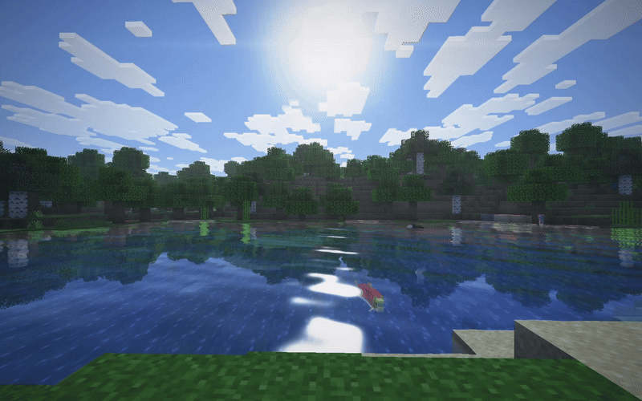
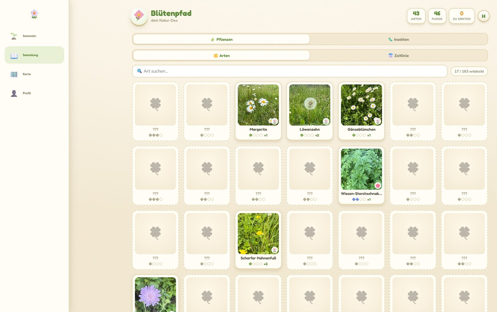
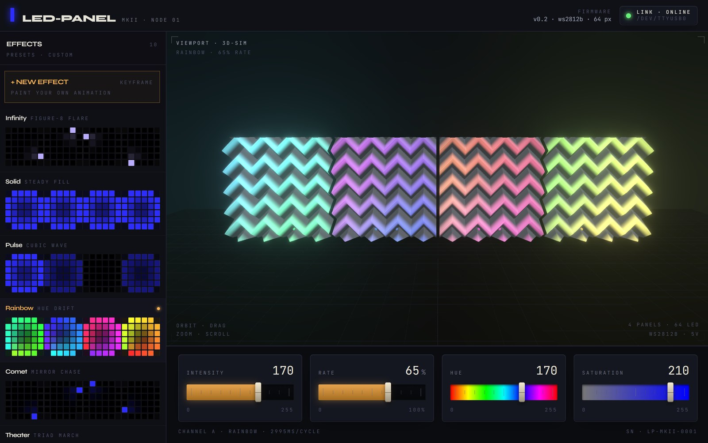
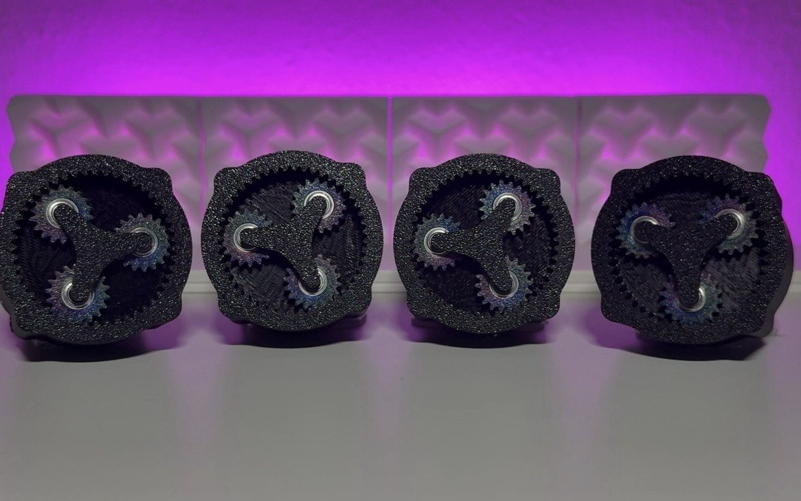
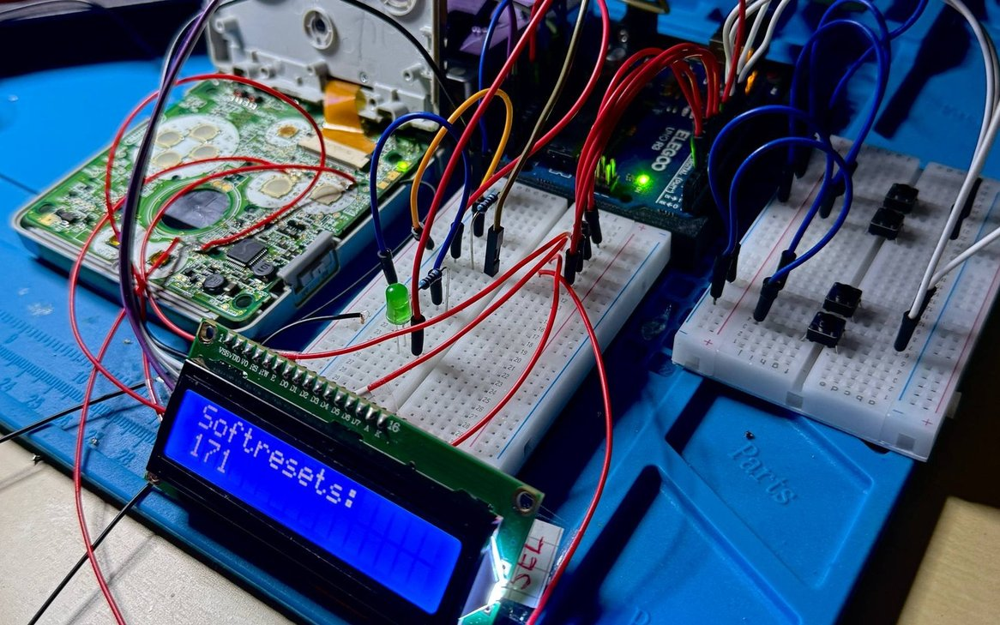

<p align="center">
  
</p>

Hi, I'm Hannes, an IT systems electronics engineer from Germany. In my free time I build hardware and software
projects with Claude Code and Codex.

```
●──────┬────[ 330Ω ]────┬────>|────┬────────────────●
       ╰──────||────────╯          ╰──── projects
```

## Projects

<table>
  <tr>
    <td width="50%" valign="top">
      <h3><a href="https://github.com/hildlabs/horizon-shaders">Daybreak</a></h3>
      <a href="https://github.com/hildlabs/horizon-shaders">
        
      </a>
      A shader pack for <a href="https://github.com/horizon-rust/horizon">Horizon</a>, the Rust
      reimplementation of Minecraft. Sun shadows, reflective water, waving plants, sun rays and
      bloom, in four quality presets.
      <br><br>
      <code>WGSL</code> <code>Rust</code>
    </td>
    <td width="50%" valign="top">
      <h3><a href="https://github.com/hildlabs/openrig-studio">OpenRig Studio</a></h3>
      <a href="https://github.com/hildlabs/openrig-studio">
        
      </a>
      Generate Roblox R15 and R6 animations with Claude Code, the Codex CLI or your own API keys.
      Preview on a 3D rig, compare models side by side, send the clip straight to Roblox Studio.
      <br><br>
      <code>JavaScript</code> <code>Luau</code>
    </td>
  </tr>
  <tr>
    <td width="50%" valign="top">
      <h3><a href="https://github.com/hildlabs/bluetenpfad">Blütenpfad</a></h3>
      <a href="https://github.com/hildlabs/bluetenpfad">
        
      </a>
      A nature collecting app for Central Europe: photograph a plant, read its profile, fill your
      collection. Auth, EXIF photo upload, plant recognition, multiplayer and GDPR endpoints in one
      Node process with SQLite, no framework and no build step. Live at
      <a href="https://bluetenpfad.de">bluetenpfad.de</a>.
      <br><br>
      <code>JavaScript</code> <code>Node.js</code> <code>SQLite</code>
    </td>
    <td width="50%" valign="top">
      <h3><a href="https://github.com/hildlabs/led-panels">LED Panels</a></h3>
      <a href="https://github.com/hildlabs/led-panels">
        
      </a>
      3D-printed wall panels, each lit from behind by 16 WS2812B LEDs. ESP8266 firmware with ten
      effects, a USB serial bridge because the Wi-Fi at the wall is too weak, and a React and
      Three.js dashboard that previews every effect in 3D and has a keyframe editor.
      <br><br>
      <code>C++</code> <code>Python</code> <code>TypeScript</code>
    </td>
  </tr>
  <tr>
    <td width="50%" valign="top">
      <h3><a href="https://github.com/hildlabs/stepper-music">Stepper Music</a></h3>
      <a href="https://github.com/hildlabs/stepper-music">
        
      </a>
      Four NEMA17 stepper motors on an Arduino play four-part music. A dashboard turns MIDI files
      into four voices, flashes the UNO over a USB bridge and syncs the LED panels to every note.
      Recordings on <a href="https://www.youtube.com/@steppersounds/videos">YouTube</a>.
      <br><br>
      <code>C++</code> <code>Python</code> <code>JavaScript</code>
    </td>
    <td width="50%" valign="top">
      <h3><a href="https://github.com/hildlabs/gba-rig">GBA Shiny Hunting Rig</a></h3>
      <a href="https://github.com/hildlabs/gba-rig">
        
      </a>
      An Arduino soft-resets a real GBA SP until the starter is shiny. It presses the buttons through
      wires soldered to the mainboard, and an LDR on the screen times the battle text box: the shiny
      sparkle animation makes it appear later.
      <br><br>
      <code>C++</code> <code>Arduino</code>
    </td>
  </tr>
</table>
