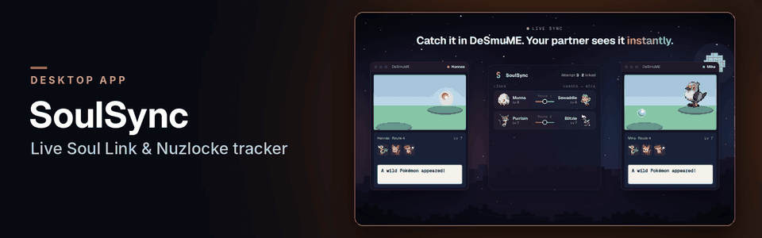
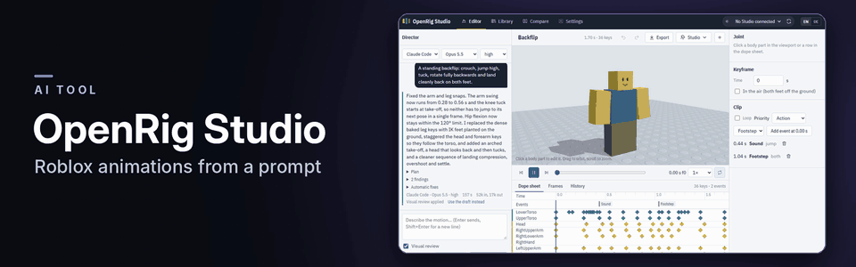
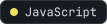
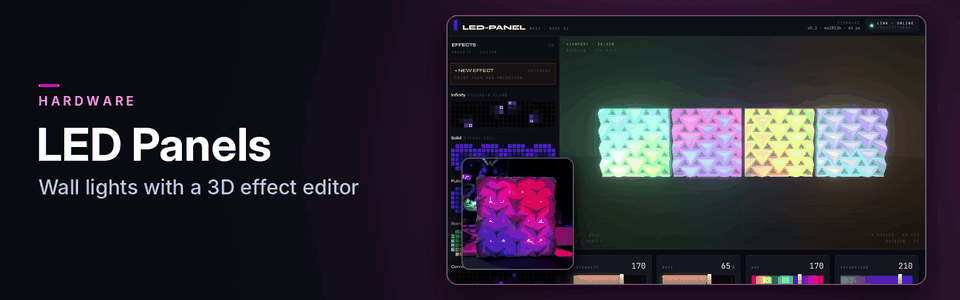
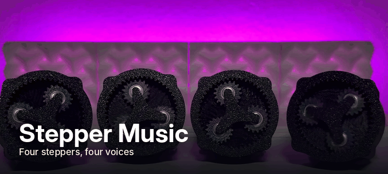

  

Live tracker for Pokémon Soul Link and Nuzlocke runs, straight from the emulator. A Lua script in DeSmuME reads the game, a Rust desktop app syncs every catch and faint to up to four players over WebSocket, and a byte-exact Rust port of a DS ROM randomizer is built in.

  &nbsp;   

Sun shadows, reflective water, waving plants and sun rays for Horizon, the Rust reimplementation of Minecraft.

  &nbsp;  

Describe a move, get a Roblox animation. Runs on Claude Code, the Codex CLI or your own API keys.

  &nbsp;  

Photograph a wild plant, read its profile, fill your collection. One Node process with SQLite, no framework.

  &nbsp;   

3D-printed wall panels with ESP8266 firmware and a React and Three.js dashboard that previews every effect in 3D.

  &nbsp;   

Four stepper motors on an Arduino play four-part music, with the LED panels synced to every note.

  &nbsp;   

An Arduino soft-resets a real GBA SP until the starter is shiny, wired straight to the mainboard.

 &nbsp;  
