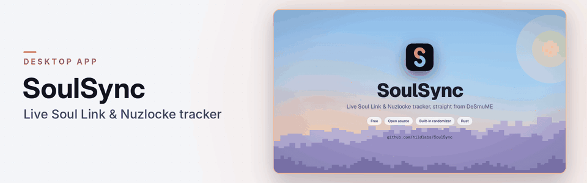
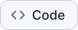
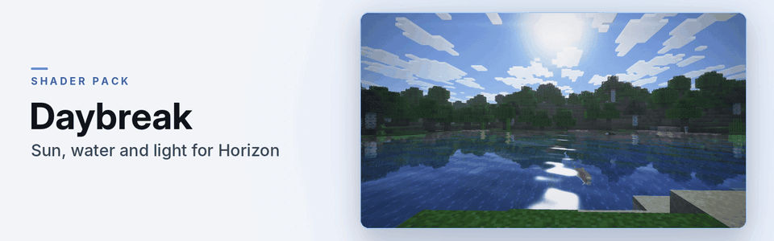
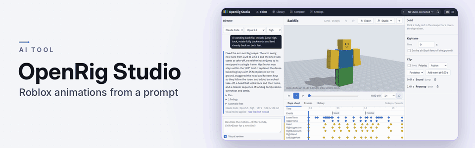
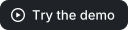
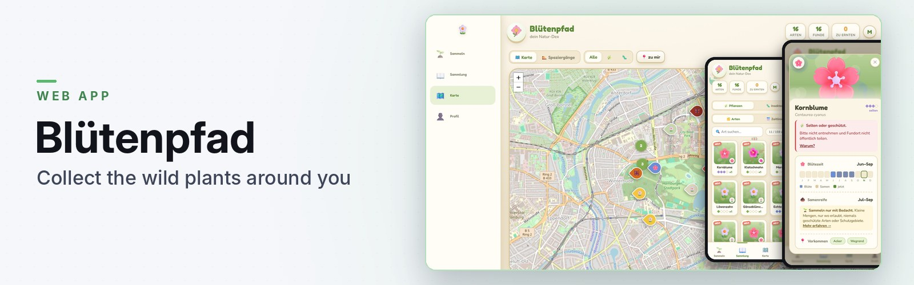
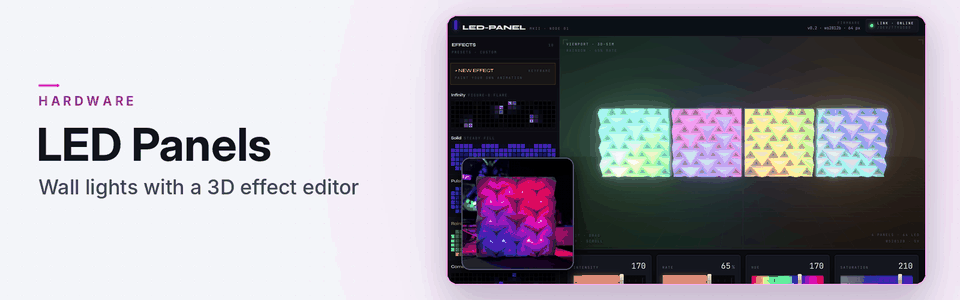
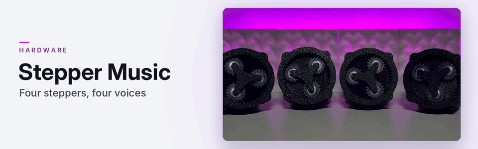
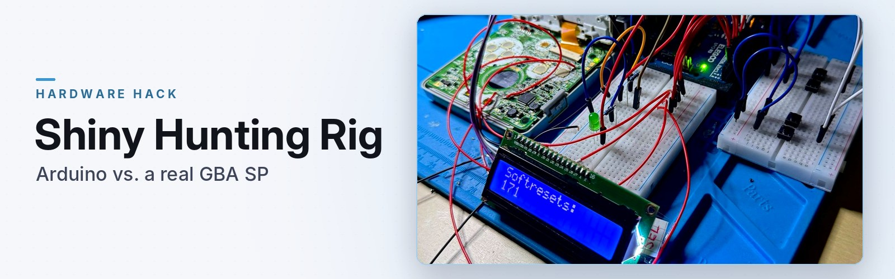

  <picture><source media="(prefers-color-scheme: dark)" srcset="assets/banner.svg"></picture>

<a href="https://github.com/hildlabs/SoulSync"><picture><source media="(prefers-color-scheme: dark)" srcset="assets/covers/soulsync.gif"></picture></a>

Live tracker for Pokémon Soul Link and Nuzlocke runs, straight from the emulator. A Lua script in DeSmuME reads the game, a Rust desktop app syncs every catch and faint to up to four players over WebSocket, and a byte-exact Rust port of a DS ROM randomizer is built in.

<a href="https://github.com/hildlabs/SoulSync/releases/latest"><picture><source media="(prefers-color-scheme: dark)" srcset="assets/chips/btn-download-dark.svg"></picture></a> <a href="https://github.com/hildlabs/SoulSync"><picture><source media="(prefers-color-scheme: dark)" srcset="assets/chips/btn-code-dark.svg"></picture></a> &nbsp; <picture><source media="(prefers-color-scheme: dark)" srcset="assets/chips/rust-dark.svg"></picture> <picture><source media="(prefers-color-scheme: dark)" srcset="assets/chips/websocket-dark.svg"></picture> <picture><source media="(prefers-color-scheme: dark)" srcset="assets/chips/lua-dark.svg"></picture>

<a href="https://github.com/hildlabs/horizon-shaders"><picture><source media="(prefers-color-scheme: dark)" srcset="assets/covers/daybreak.gif"></picture></a>

Sun shadows, reflective water, waving plants and sun rays for Horizon, the Rust reimplementation of Minecraft.

<a href="https://playhorizon.dev/mods/daybreak"><picture><source media="(prefers-color-scheme: dark)" srcset="assets/chips/btn-get-dark.svg"></picture></a> <a href="https://github.com/hildlabs/horizon-shaders"><picture><source media="(prefers-color-scheme: dark)" srcset="assets/chips/btn-code-dark.svg"></picture></a> &nbsp; <picture><source media="(prefers-color-scheme: dark)" srcset="assets/chips/wgsl-dark.svg"></picture> <picture><source media="(prefers-color-scheme: dark)" srcset="assets/chips/rust-dark.svg"></picture>

<a href="https://github.com/hildlabs/openrig-studio"><picture><source media="(prefers-color-scheme: dark)" srcset="assets/covers/openrig.gif"></picture></a>

Describe a move, get a Roblox animation. Runs on Claude Code, the Codex CLI or your own API keys.

<a href="https://hildlabs.github.io/openrig-studio/"><picture><source media="(prefers-color-scheme: dark)" srcset="assets/chips/btn-demo-dark.svg"></picture></a> <a href="https://github.com/hildlabs/openrig-studio"><picture><source media="(prefers-color-scheme: dark)" srcset="assets/chips/btn-code-dark.svg"></picture></a> &nbsp; <picture><source media="(prefers-color-scheme: dark)" srcset="assets/chips/javascript-dark.svg"></picture> <picture><source media="(prefers-color-scheme: dark)" srcset="assets/chips/luau-dark.svg"></picture>

<a href="https://github.com/hildlabs/bluetenpfad"><picture><source media="(prefers-color-scheme: dark)" srcset="assets/covers/bluetenpfad.jpg"></picture></a>

Photograph a wild plant, read its profile, fill your collection. One Node process with SQLite, no framework.

<a href="https://bluetenpfad.de"><picture><source media="(prefers-color-scheme: dark)" srcset="assets/chips/btn-live-dark.svg"></picture></a> <a href="https://github.com/hildlabs/bluetenpfad"><picture><source media="(prefers-color-scheme: dark)" srcset="assets/chips/btn-code-dark.svg"></picture></a> &nbsp; <picture><source media="(prefers-color-scheme: dark)" srcset="assets/chips/javascript-dark.svg"></picture> <picture><source media="(prefers-color-scheme: dark)" srcset="assets/chips/nodejs-dark.svg"></picture> <picture><source media="(prefers-color-scheme: dark)" srcset="assets/chips/sqlite-dark.svg"></picture>

<a href="https://github.com/hildlabs/led-panels"><picture><source media="(prefers-color-scheme: dark)" srcset="assets/covers/led-panels.gif"></picture></a>

3D-printed wall panels with ESP8266 firmware and a React and Three.js dashboard that previews every effect in 3D.

<a href="https://hildlabs.github.io/led-panels/"><picture><source media="(prefers-color-scheme: dark)" srcset="assets/chips/btn-demo-dark.svg"></picture></a> <a href="https://github.com/hildlabs/led-panels"><picture><source media="(prefers-color-scheme: dark)" srcset="assets/chips/btn-code-dark.svg"></picture></a> &nbsp; <picture><source media="(prefers-color-scheme: dark)" srcset="assets/chips/cpp-dark.svg"></picture> <picture><source media="(prefers-color-scheme: dark)" srcset="assets/chips/python-dark.svg"></picture> <picture><source media="(prefers-color-scheme: dark)" srcset="assets/chips/typescript-dark.svg"></picture>

<a href="https://github.com/hildlabs/stepper-music"><picture><source media="(prefers-color-scheme: dark)" srcset="assets/covers/stepper-music.gif"></picture></a>

Four stepper motors on an Arduino play four-part music, with the LED panels synced to every note.

<a href="https://www.youtube.com/@steppersounds/videos"><picture><source media="(prefers-color-scheme: dark)" srcset="assets/chips/btn-video-dark.svg"></picture></a> <a href="https://github.com/hildlabs/stepper-music"><picture><source media="(prefers-color-scheme: dark)" srcset="assets/chips/btn-code-dark.svg"></picture></a> &nbsp; <picture><source media="(prefers-color-scheme: dark)" srcset="assets/chips/cpp-dark.svg"></picture> <picture><source media="(prefers-color-scheme: dark)" srcset="assets/chips/python-dark.svg"></picture> <picture><source media="(prefers-color-scheme: dark)" srcset="assets/chips/javascript-dark.svg"></picture>

<a href="https://github.com/hildlabs/gba-rig"><picture><source media="(prefers-color-scheme: dark)" srcset="assets/covers/gba-rig.jpg"></picture></a>

An Arduino soft-resets a real GBA SP until the starter is shiny, wired straight to the mainboard.

<a href="https://github.com/hildlabs/gba-rig"><picture><source media="(prefers-color-scheme: dark)" srcset="assets/chips/btn-code-dark.svg"></picture></a> &nbsp; <picture><source media="(prefers-color-scheme: dark)" srcset="assets/chips/cpp-dark.svg"></picture> <picture><source media="(prefers-color-scheme: dark)" srcset="assets/chips/arduino-dark.svg"></picture>
